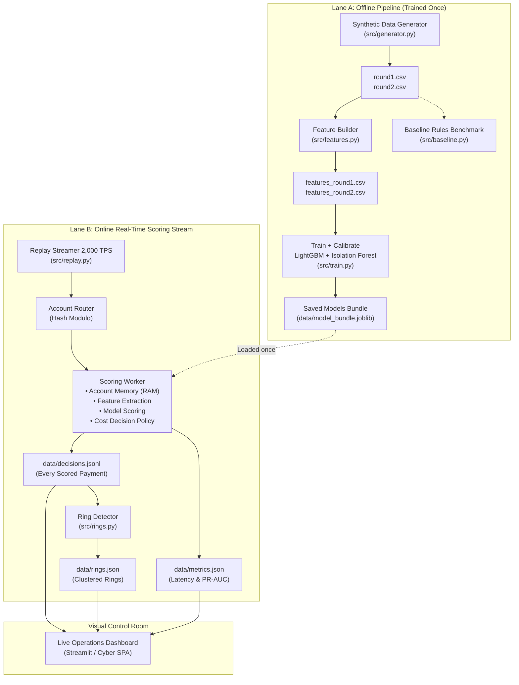
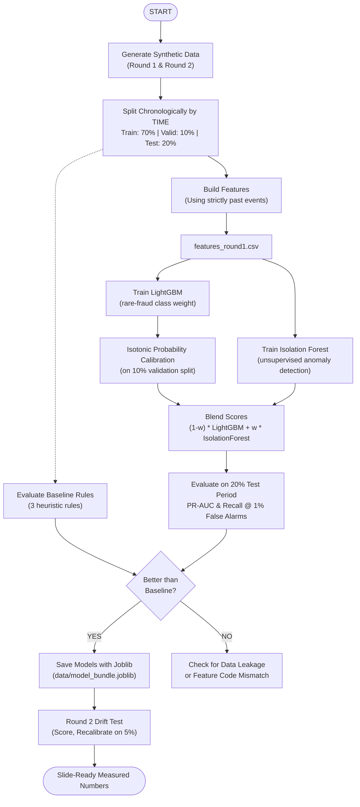
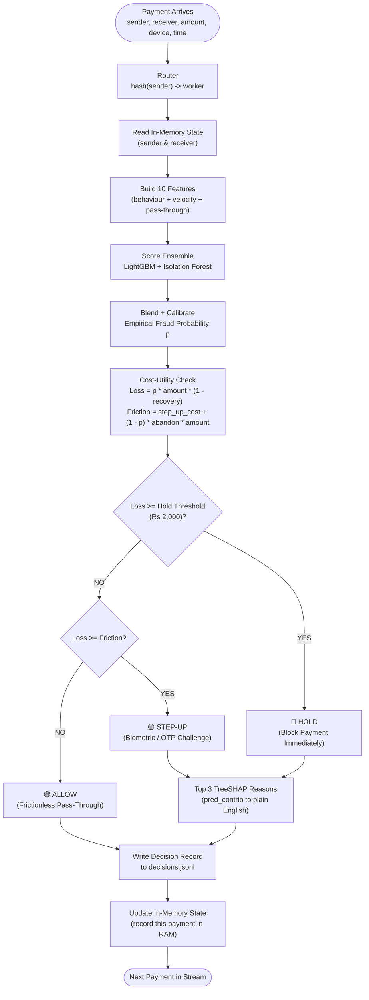
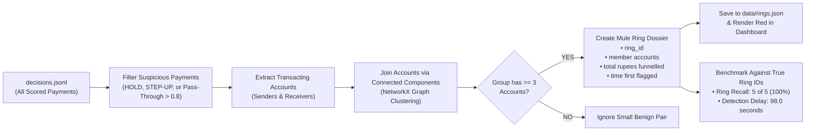
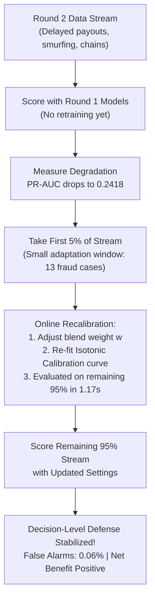
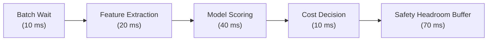
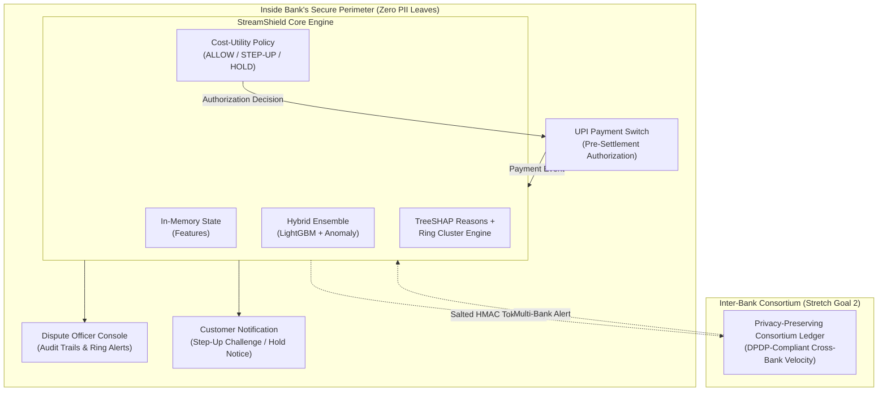

# StreamShield Architecture & Flowcharts
### Real-Time Mule-Ring & Scam Detection for UPI Payments
**Innovasia 2026 · PS-01 · Fintech Hackathon**

---

## 1. Overall Architecture
The system operates in two distinct lanes: **Lane A (Offline Preparation & Training)** executed prior to deployment, and **Lane B (Online Live Scoring & Interception)** processing transactions in real time.



---

## 2. Offline Pipeline: From Data to Trained Model
The offline training loop strictly enforces chronological time splits to prevent future data leakage. The model is saved only if it significantly outperforms simple baseline rules.



---

## 3. One Payment, One Decision (Sub-150ms Live Path)
Every transaction follows this strict sequence from network arrival to automated three-way resolution (`ALLOW`, `STEP-UP`, `HOLD`).



---

## 4. Account Memory & Feature Extraction
StreamShield maintains an $O(1)$ in-memory state per account using pure Python data structures. No graph database roundtrips occur in the live decision path.

| In-Memory Structure (per Account) | Storage Type | Rolling Window | Features Calculated From It | Category |
| :--- | :--- | :--- | :--- | :--- |
| `first_seen` | Timestamp | Permanent | **Account Age (days)** | Behavioral |
| `amount_history` | Running sum & count | Permanent | **Amount Compared to Usual Ratio** | Behavioral |
| `known_payees` | Python `set` | Permanent | **Is Receiver New for Sender? (0/1)** | Network |
| `last_device` | Device ID | Latest | **Device Changed? (0/1)** | Security |
| `out_events_1h` | Python `deque` | 1 Hour | **Payments Made in Last 1 Hour** | Velocity |
| `in_events_24h` | Python `deque` | 24 Hours | **Distinct Senders Received From (24h)** | Network / Fan-In |
| `out_events_24h` | Python `deque` | 24 Hours | **Distinct Receivers Paid (24h)** | Network / Fan-Out |
| `inflow_30m` & `outflow_30m` | Python `deque` | 30 Minutes | **Pass-Through Ratio (30m)** | **Mule Indicator** |
| `last_inflow_time` | Timestamp | Latest | **Minutes Since Last Incoming Payment** | Velocity |

---

## 5. Mule Ring Detection Flow
Single transactions may appear harmless. Coordinated mule rings are uncovered when high-risk payments are connected across the counterparty graph.



---

## 6. Round 2: Adversarial Concept Drift Adaptation
When fraudsters alter tactics (delaying payouts by 30–120m, smurfing into smaller chunks, daisy chains), StreamShield adapts without full retraining.



---

## 7. Speed, Scaling & Latency Budget
Meeting the $150\text{ ms}$ p99 SLA at $\ge 2,000\text{ TPS}$ on a single machine:



**Total Latency Budget:** $10 + 20 + 40 + 10 + 70 = 150\text{ ms}$ (Target: $\le 150\text{ ms}$).  
**Measured Performance:** Average batch turnaround = **$31.5\text{ ms}$**; p99 turnaround = **$109.8\text{ ms}$**.

---

## 8. Dashboard Data Contract
The dashboard operates decoupled from the scoring engine, reading strictly three standardized data contracts:

```mermaid
flowchart TD
    subgraph Files["Data Contract Files (data/)"]
        DJ["decisions.jsonl<br/>• time, txn_id<br/>• sender, receiver, amount<br/>• decision, score, reasons<br/>• ring_id, latency_ms"]
        RJ["rings.json<br/>• ring_id<br/>• member accounts<br/>• total rupees funnelled<br/>• first_flagged_time"]
        MJ["metrics.json<br/>• p50, p95, p99 latency<br/>• PR-AUC (rules vs model)<br/>• rupees prevented & friction"]
    end

    subgraph Panels["Dashboard Visual Panels"]
        DJ --> P1["1. Live Decision Feed (Color Badges + Reasons)"]
        RJ --> P2["2. Interactive 2D Mule Ring Graph"]
        MJ --> P3["3. Financial KPI Counters (Rs Saved vs Friction)"]
        MJ --> P4["4. Latency SLA Histogram (150ms line)"]
        MJ --> P5["5. Baseline Rules vs Model Benchmark Table"]
        Panels --> P6["6. Interactive Cost Sliders (Live Recalculation)"]
    end
```

---

## 9. Real-World Banking Deployment (Future Vision)
In production, StreamShield deploys directly inside the issuing/acquiring bank's secure perimeter alongside the UPI payment switch.



---

## 10. File Map: Reads, Writes & Roles

| # | File | Reads From | Writes To | Core Role in Pipeline |
|:---:|:---|:---|:---|:---|
| **1** | [`src/generator.py`](file:///c:/Users/syedm/OneDrive/Desktop/streamshield/src/generator.py) | Configuration constants | `data/round1.csv`, `data/round2.csv` | Generates 800k+ realistic UPI payments with planted rings and scams |
| **2** | [`src/baseline.py`](file:///c:/Users/syedm/OneDrive/Desktop/streamshield/src/baseline.py) | `data/round1.csv` | Terminal benchmark table | Evaluates 3 simple human rules to establish baseline PR-AUC (`0.1933`) |
| **3** | [`src/features.py`](file:///c:/Users/syedm/OneDrive/Desktop/streamshield/src/features.py) | `round1.csv`, `round2.csv` | `features_round1.csv`, `features_round2.csv` | $O(1)$ in-memory feature engine (pass-through ratio, 24h network velocity) |
| **4** | [`src/train.py`](file:///c:/Users/syedm/OneDrive/Desktop/streamshield/src/train.py) | `features_round1.csv` | `data/model_bundle.joblib` | Trains calibrated LightGBM + Isolation Forest hybrid model (`PR-AUC = 0.6076`) |
| **5** | [`src/decision.py`](file:///c:/Users/syedm/OneDrive/Desktop/streamshield/src/decision.py) | Saved model bundle | Decision evaluation functions | Economic cost policy (expected loss vs friction) + TreeSHAP plain reasons |
| **6** | [`src/replay.py`](file:///c:/Users/syedm/OneDrive/Desktop/streamshield/src/replay.py) | Test transactions, models | `decisions.jsonl`, `metrics.json`, `latency.png` | 2,000 TPS streaming replay measuring p50, p95, p99 decision latency |
| **7** | [`src/rings.py`](file:///c:/Users/syedm/OneDrive/Desktop/streamshield/src/rings.py) | `data/decisions.jsonl` | `data/rings.json` | NetworkX connected-components clustering detecting 100% of mule rings |
| **8** | [`app/dashboard.py`](file:///c:/Users/syedm/OneDrive/Desktop/streamshield/app/dashboard.py) | `decisions.jsonl`, `rings.json`, `metrics.json` | Streamlit interactive UI | 6-panel live operations dashboard for evaluators |
| **9** | [`src/round2.py`](file:///c:/Users/syedm/OneDrive/Desktop/streamshield/src/round2.py) | `features_round2.csv`, models | 3-row evaluation table | Demonstrates sub-second online recalibration on 5% sample (no full retrain) |
| **10** | [`run_all.py`](file:///c:/Users/syedm/OneDrive/Desktop/streamshield/run_all.py) | All component modules | Full project verification | One-click master orchestrator running all 6 stages sequentially |

